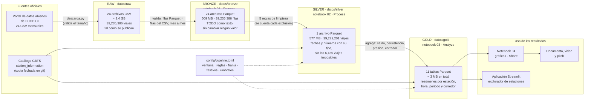
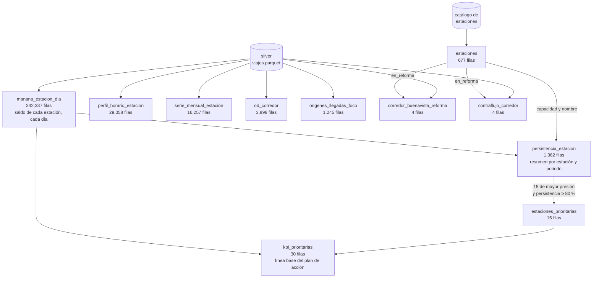

# Las capas de datos (medallion): qué contiene cada una y qué resultó de cada fase

Este documento explica, capa por capa, **qué datos hay, de dónde salen, qué se les hizo y cuántos registros quedaron**.
Sirve para que cualquier integrante (o quien califique) pueda abrir una carpeta de `datos/` y saber qué está viendo.

- Cómo se ejecuta y cómo está organizado el código: [`arquitectura_pipeline.md`](arquitectura_pipeline.md).
- Por qué se tomó cada decisión de limpieza o cálculo: [`bitacora_decisiones.md`](bitacora_decisiones.md) (se cita como D-xx).
- Significado de las columnas de los CSV originales: [`diccionario_datos.md`](diccionario_datos.md).
- Estado de la información: ventana **2024-11 a 2026-10** (24 meses, D-06). Las cifras salen de lo ejecutado el 2026-11-21.

---

## 1. Vista general



| Capa | Carpeta | Pregunta que responde | Filas | Tamaño | ¿Va a git? |
|---|---|---|---|---|---|
| **raw** | `datos/raw/` | ¿Qué publica ECOBICI? | 39,235,386 (24 CSV) | ≈ 2.4 GB | No |
| **bronze** | `datos/bronze/` | ¿Llegó completo y sin cambios? | 39,235,386 (24 Parquet) | 509 MB | No |
| **silver** | `datos/silver/` | ¿Qué viajes son confiables y con qué tipos? | 39,229,201 (1 Parquet) | 577 MB | No |
| **gold** | `datos/gold/` | ¿Qué estaciones se vacían o se llenan, cuándo y cuánto? | 11 tablas, de 4 a 342,337 filas | ≈ 3 MB | No (D-23) |

> **Por qué ni silver ni gold van a git:** se regeneran con `python -m pipeline`, que da exactamente las mismas tablas con las versiones fijas de
> `requirements.txt` (D-20 y D-23). Lo que sí se versiona es el catálogo de estaciones con fecha y los diagnósticos de `datos/perfil/`.

Cada capa conserva a la anterior. Si una cifra del análisis parece rara, se puede bajar a la capa de abajo para revisarla:
gold → silver → bronze → CSV.

---

## 2. Fuentes y enlaces

Todo dato del proyecto sale de una fuente pública. Estas son las direcciones, para poder reproducir o revisar cada una.

| Fuente | Quién la publica | Dirección | Para qué se usa |
|---|---|---|---|
| **Viajes de ECOBICI** (página de datos abiertos) | ECOBICI, Gobierno de la Ciudad de México | <https://ecobici.cdmx.gob.mx/datos-abiertos/> | Es la página que el programa lee para encontrar los 24 CSV mensuales de la ventana (`[portal]` en `config/pipeline.toml`) |
| **Archivos CSV de cada mes** | ECOBICI | `https://ecobici.cdmx.gob.mx/wp-content/uploads/AAAA/MM/<archivo>.csv` (ver abajo) | Capa raw. El programa extrae los enlaces de la página; no están escritos a mano |
| **Catálogo de estaciones** (GBFS `station_information`) | Sistema ECOBICI (feed público GBFS) | <https://gbfs.mex.lyftbikes.com/gbfs/es/station_information.json> | Nombre, coordenadas y capacidad de las 677 estaciones (`[catalogo]`). Solo publica el estado **actual** |
| **Captura histórica del catálogo** (2024-11-07) | Internet Archive (Wayback Machine) | <https://web.archive.org/web/20241107193422id_/https://gbfs.mex.lyftbikes.com/gbfs/es/station_information.json> | Solo para comprobar cuánto cambió la capacidad desde el inicio de la ventana (D-16) |
| **Contorno y colonias de la CDMX** | SIEG, Gobierno de la Ciudad de México | <https://sieg.cdmx.gob.mx/geoserver/ows> (servicio WFS) | Capa `geonode:cdmx_de_seduvi` para el contorno de los mapas (D-18) y `geonode:im_colonia` para ubicar estaciones por colonia (D-24) |
| **Días de descanso obligatorio** | Ley Federal del Trabajo, art. 74 | <https://www.diputados.gob.mx/LeyesBiblio/pdf/LFT.pdf> | Los 14 festivos que no cuentan como días laborables (`festivos` en `config/pipeline.toml`, D-13) |
| **Estándar GBFS** | MobilityData | <https://gbfs.org> | Referencia del formato del catálogo de estaciones |

**Cómo son las direcciones de los CSV.** Los nombres de archivo no siguen un patrón y la carpeta es la del año y mes de publicación (casi siempre el mes siguiente al que contienen). Ejemplos de la ventana:

- `https://ecobici.cdmx.gob.mx/wp-content/uploads/2024/12/2024-11.csv` (viajes de 2024-11)
- `https://ecobici.cdmx.gob.mx/wp-content/uploads/2026/07/public_data_web_2026-06.csv` (viajes de 2026-06)

Por eso `pipeline/descarga.py` lee la página de datos abiertos y extrae las 24 direcciones, y se detiene si encuentra más de un enlace para el mismo mes.

> Las direcciones se verificaron el 2026-11-21 (todas respondieron). El catálogo de ECOBICI cambia con el tiempo, por eso el proyecto usa la copia fechada de `datos/catalogo/` y no la dirección en vivo (`usar_copia_versionada = true`).

---

## 3. Raw: los CSV tal como los publica ECOBICI

- **Qué es:** un CSV por mes, descargado leyendo la página de datos abiertos de ECOBICI (<https://ecobici.cdmx.gob.mx/datos-abiertos/>; los nombres de archivo no siguen un patrón; más enlaces en la sección 2).
- **Resultado:** 24 archivos, de `2024-11.csv` a `2026-10.csv`, ≈ 2.4 GB, 39,235,386 viajes. La descarga verifica que el tamaño coincida con el que anuncia el servidor y,
  si se corta, reintenta y retoma lo que falta (D-20).
- **Columnas:** las 9 originales (género, edad, bici, estación y fecha/hora de retiro, estación y fecha/hora de arribo). Ver `diccionario_datos.md`.
- **Se conserva sin tocar.** Los archivos están organizados por fecha de **arribo**, así que cada mes abre con algunos retiros del mes anterior.

### Catálogo de estaciones (fuente complementaria)

- **Archivos:** `datos/catalogo/station_information_2026-11-20.json` (el que usa el análisis) y `station_information_2024-11-07.json` (captura histórica para comprobar la capacidad, D-16).
- **Fuente:** <https://gbfs.mex.lyftbikes.com/gbfs/es/station_information.json> (la de 2024-11-07 viene de Internet Archive; ver sección 2).
- **Qué aporta:** nombre, coordenadas y **capacidad** de las 677 estaciones. La capacidad es la **vigente al 2026-11-20**, no la de cada mes (limitación declarada; cambió en 9 de 677 estaciones, ninguna prioritaria).
- **Complemento:** `datos/catalogo/colonias_estaciones_foco_2026-11-21.csv` ubica 20 estaciones de interés en su colonia y alcaldía (D-24). No entra en ningún cálculo.

---

## 4. Bronze: los mismos datos, en un formato más rápido, sin cambios

- **Objetivo:** guardar los datos originales en Parquet para poder consultarlos rápido, y **comprobar que no se perdió ni una fila**.
- **Producido por:** `pipeline/bronze.py`, ejecutado desde el notebook `01_perfilado.ipynb` (fase *Prepare*).
- **Resultado:** 24 archivos `datos/bronze/AAAA-MM.parquet`, 509 MB, **39,235,386 filas, idéntico al total de los CSV**. La validación se hace mes por mes y detiene el proceso si un solo mes no coincide.
- **Qué NO hace:** no limpia, no convierte tipos, no filtra.

| Columna | Tipo | Significado |
|---|---|---|
| `genero`, `edad`, `bici` | texto | Los datos del usuario y la bicicleta, tal como vienen |
| `est_retiro`, `est_arribo` | texto | Código de la estación (se lee como **texto** para no perder los ceros: `015`; hay códigos dobles como `271-272`) |
| `fecha_retiro`, `hora_retiro`, `fecha_arribo`, `hora_arribo` | texto | Fechas `dd/mm/aaaa` y horas `HH:MM:SS` sin interpretar |
| `mes_archivo` | texto | **Única columna añadida:** el mes del archivo de origen (`2024-11`) |

**Por qué todo como texto:** al dejar que DuckDB adivinara los tipos de todos los CSV a la vez se perdieron dos meses sin aviso (D-03, ≈ 3.7 millones de viajes en la exploración inicial).

### Qué se aprendió en esta fase (perfilado, sin corregir nada)

Resultados en `datos/perfil/calidad_por_mes.csv` (una fila por mes: viajes, porcentaje de género, edades vacías o con decimal, estaciones, códigos dobles y estaciones temporales):

- Sin celdas vacías ni duplicados exactos; los 24 encabezados son idénticos (D-07).
- Desde 2026-06 la edad viene con decimal (`26.0`).
- Hay códigos de estación dobles (`271-272`, estaciones contiguas) y algunas estaciones sin catálogo (`Temporal 1` a `4`, `1000`).
- Hay edades imposibles (por ejemplo 162 años), probables errores de captura en el origen; no se corrigen porque la edad no interviene en el análisis (D-12).
- Gráfica de apoyo: `figuras/01_viajes_por_mes.png`.

---

## 5. Silver: viajes confiables, con sus tipos correctos

- **Objetivo:** dejar una sola tabla de viajes en la que se pueda calcular (fechas como fechas, duración en segundos) y de la que se hayan quitado los registros imposibles.
- **Producido por:** `pipeline/silver.py`, ejecutado desde `02_limpieza.ipynb` (fase *Process*).
- **Resultado:** `datos/silver/viajes.parquet`, 577 MB, **39,229,201 viajes (99.984 %)**. Se excluyeron **6,185** (0.016 %).

### Reglas de limpieza

Un viaje se excluye en la **primera** regla que incumple (el orden importa para el conteo). Los umbrales están en `config/pipeline.toml`.

| Orden | Regla | Excluidos |
|---|---|---|
| 1 | `fecha_invalida`: la fecha u hora no se puede interpretar | 0 |
| 2 | `duracion_negativa`: el arribo es anterior al retiro | 0 |
| 3 | `menos_de_1_min`: dura menos de 60 segundos (alguien saca la bici y la devuelve) | **5,027** (0.013 %) |
| 4 | `mas_de_24_h`: dura más de 24 horas (error o bici no devuelta) | **1,158** (0.003 %) |
| 5 | `retiro_muy_antiguo`: retiro anterior al mes previo al del archivo | 0 |

El detalle por motivo está en `datos/perfil/limpieza_resumen.csv`. **No se excluyen** los viajes que regresan a la misma estación (uso real), ni los que tienen una estación sin catálogo
(≈ 610 viajes: sus movimientos son reales, solo no tienen capacidad conocida), ni se corrigen la edad o el género.

### Columnas

| Columna | Tipo | Qué cambió respecto a bronze |
|---|---|---|
| `genero` | texto | Igual (no se corrige) |
| `edad` | entero | Texto → entero; `26.0` y `26` quedan como `26`; vacía si no se puede leer |
| `est_retiro`, `est_arribo` | texto | Igual (con ceros) |
| `ts_retiro`, `ts_arribo` | fecha y hora | **Nueva:** fecha + hora ya interpretadas (sustituyen a las 4 columnas de texto de fecha y hora) |
| `duracion_s` | entero | **Nueva:** duración del viaje en segundos |
| `mes_archivo` | texto | Igual |
| `retiro_en_catalogo`, `arribo_en_catalogo` | verdadero/falso | **Nuevas:** si el código de la estación existe en el catálogo |

La columna `bici` **no pasa a silver**: no interviene en ningún cálculo.

### Validación

El programa comprueba que lo guardado coincida con el conteo de conservados y que, mes por mes, **conservados + excluidos = total de bronze**. Si no cuadra, se detiene.

---

## 6. Gold: tablas resumidas para responder las preguntas

- **Objetivo:** convertir 39 millones de viajes en pocas tablas pequeñas, **una por pregunta**, que se puedan abrir, graficar y explicar.
- **Producido por:** `pipeline/gold.py`, ejecutado desde `03_analisis.ipynb` (fase *Analyze*). El notebook 04 y la aplicación **solo leen** estas tablas.
- **Resultado:** **11 tablas** en `datos/gold/`, ≈ 3 MB en total.
- **Validación:** antes de guardar, se recuentan las salidas y llegadas de la franja de la mañana directamente en silver y se comparan con la suma de gold. Cuadran exactamente (7,633,768 salidas y 7,602,688 llegadas, D-13); si no, el proceso se detiene.

### 6.1. Definiciones comunes (valen para todas las tablas)

| Término | Definición | Dónde se fija |
|---|---|---|
| **Periodo** | Dos años de 12 meses: `2024-11 a 2025-10` y `2025-11 a 2026-10`. Las cifras «vigentes» son las del segundo | `[[periodos]]` en `config/pipeline.toml` |
| **Franja de la mañana** | De 07:00 a 10:59 (horas 7 a 10) | D-13; `[analisis]` |
| **Día laborable** | Lunes a viernes, **sin** los 14 días de descanso obligatorio (festivos oficiales) | D-13; `festivos` |
| **Salida / llegada** | Un viaje cuenta como una salida en la estación y hora de retiro, y como una llegada en la estación y hora de arribo | |
| **Saldo** | Llegadas − salidas. Positivo: la estación **se llena**. Negativo: **se vacía** | |
| **Día de actividad** | Día en que la estación tuvo al menos un viaje. Los promedios se dividen entre los días de actividad (un día cerrado no cuenta como saldo 0) | D-13 |
| **Capacidad** | Número de anclajes de la estación, del catálogo vigente al 2026-11-20 | D-16 |
| **Presión** | Saldo medio ÷ capacidad. Una presión de 3 significa que, en promedio, llegan 3 veces más bicis de las que caben | |
| **Umbral de persistencia** | 5 bicis: un día «gana» o «pierde» si el saldo es ≥ 5 o ≤ −5 | `umbral_persistencia_bicis` |
| **Estaciones de Reforma** | Las 24 del catálogo cuyo nombre contiene «reforma» | D-14; `reforma_texto_en_nombre` |
| **Grupo Buenavista** | Núcleo: 266-267, 268-269, 271-272, 273-274. Ampliado: núcleo + 548, 547, 176 | D-13, D-24 |

### 6.2. Cómo se relacionan las tablas



### 6.3. Ficha de cada tabla

En todas, `est` es el código de la estación como texto (`014`, `271-272`) y `periodo` es uno de los dos periodos de 12 meses.

#### `estaciones` · el catálogo
- **Grano:** una fila por estación · **677 filas**.
- **Para qué sirve:** nombre, coordenadas y capacidad; es la tabla que se une a las demás.
- **Columnas:** `codigo`, `nombre`, `lat`, `lon`, `capacidad` (anclajes; vigente al 2026-11-20), `en_reforma` (verdadero en 24 estaciones).
- **Se usa en:** notebooks 01 a 04 y la aplicación.

#### `manana_estacion_dia` · el saldo de cada estación, cada día
- **Grano:** estación × día laborable con actividad · **342,337 filas** (171,840 en el primer periodo y 170,497 en el segundo).
- **Para qué sirve:** es la tabla base. De ella se calculan la persistencia, la presión y los indicadores.
- **Columnas:**
  - `periodo`, `est`, `dia`.
  - `salidas` y `llegadas`: viajes que salieron y llegaron entre 7:00 y 10:59.
  - `saldo`: llegadas − salidas.
  - `bicis_necesarias`: bicis que habría tenido que haber a las 7:00 para que la estación **no se quedara vacía**, llevando la cuenta viaje por viaje (si nadie la rellenara).
  - `espacios_necesarios`: lo mismo para que **no se llenara**.
  Son indicadores indirectos: los viajes no traen el inventario real de bicis.
- **Se usa en:** notebook 03.
- **Ejemplo (014, 2025-11-03):** 35 salidas, 187 llegadas, saldo +152.

#### `persistencia_estacion` · el resumen por estación
- **Grano:** estación × periodo · **1,362 filas**.
- **Para qué sirve:** responde «qué tan seguido y qué tan grande es el desbalance» de cada estación.
- **Columnas:** `periodo`, `est`, `nombre`, `capacidad`; `dias_laborables` (días laborables **con actividad** de la estación) y `dias_sin_actividad` (días laborables del periodo en que no tuvo viajes);
  `saldo_medio`; `pct_dias_gana` y `pct_dias_pierde` (porcentaje de días con saldo ≥ 5 o ≤ −5); `bicis_necesarias_media` y `_max`; `espacios_necesarios_media` y `_max`; `presion`.
- **Se usa en:** notebooks 03 y 04, y la aplicación (tarjetas y explorador).
- **Ejemplo (014, 2025-11 a 2026-10):** capacidad 39, 253 días, saldo medio +120.6, gana el 100 % de los días, presión 3.09.

#### `perfil_horario_estacion` · cómo se mueve cada estación durante el día
- **Grano:** estación × periodo × hora (0 a 23) · **29,058 filas**.
- **Columnas:** `periodo`, `est`, `hora`, `salidas_por_dia`, `llegadas_por_dia` (promedio por día de actividad, **de todas las horas**, no solo la mañana).
- **Se usa en:** notebooks 03 y 04, y el explorador de la aplicación.
- **Ejemplo (014, hora 8):** 11.5 salidas y 58.3 llegadas por día.

#### `serie_mensual_estacion` · la evolución mes a mes
- **Grano:** estación × mes · **16,257 filas**.
- **Columnas:** `periodo`, `mes` (`2025-03`), `est`, `dias` (días de actividad en el mes), `llegadas_por_dia`, `salidas_por_dia` (en la franja de la mañana).
- **Para qué sirve:** ver si el cambio de la estación 014 entre periodos fue brusco o gradual (D-14).
- **Se usa en:** notebook 03 y la aplicación.

#### `od_corredor` · a dónde van quienes salen de Buenavista
- **Grano:** origen × destino × periodo · **3,898 filas**. Solo con origen en las 4 estaciones del núcleo de Buenavista y salida en la franja de la mañana.
- **Columnas:** `periodo`, `origen`, `destino`, `viajes` (total del periodo), `viajes_por_dia` (entre los días de actividad de la estación de origen).
- **Se usa en:** notebooks 03 y 04 (gráfica de destinos).
- **Ejemplo:** 271-272 → 014 en 2025-11 a 2026-10: 1,068 viajes, 4.5 por día.

#### `origenes_llegadas_foco` · de dónde llegan las bicis a la estación 014
- **Grano:** origen × periodo, solo para el destino `014` · **1,245 filas**.
- **Columnas:** `periodo`, `destino`, `origen`, `viajes`, `viajes_por_dia` (llegadas de la franja de la mañana).
- **Para qué sirve:** medir qué parte de las llegadas a 014 viene de Buenavista (alrededor del 9 %, D-14).
- **Se usa en:** notebook 03.

#### `corredor_buenavista_reforma` · qué parte de las salidas de Buenavista termina en Reforma
- **Grano:** grupo × periodo · **4 filas** (grupo `núcleo` y `ampliado`, por dos periodos).
- **Columnas:** `periodo`, `grupo`, `dias` (días con actividad del grupo), `salidas_por_dia`, `salidas_a_reforma_por_dia`, `pct_a_reforma`.
- **Resultado (núcleo, 2025-11 a 2026-10):** 453 salidas por día, 112 a Reforma = **24.8 %** (25.2 % el periodo anterior, con 565 salidas por día).
- **Se usa en:** notebooks 03 y 04, y la aplicación.

#### `estaciones_prioritarias` · las 15 con más presión
- **Grano:** una fila por estación prioritaria · **15 filas**.
- **Cómo se eligen:** del periodo reciente, las 15 con mayor presión (en valor absoluto) entre las que gana o pierde ≥ 5 bicis en al menos el 80 % de los días (D-15).
- **Columnas:** `posicion` (1 a 15), `est`, `nombre`, `capacidad`, `saldo_medio`, `presion`, `pct_dias_gana`, `pct_dias_pierde`, `tipo` (`se llena` o `se vacía`).
- **Resultado:** 12 se llenan y 3 se vacían; la primera es la 014.
- **Se usa en:** notebooks 03 y 04, y la aplicación.

#### `kpi_prioritarias` · la línea base del plan de acción
- **Grano:** estación prioritaria × periodo · **30 filas** (15 × 2).
- **Columnas:** `periodo`, `posicion`, `est`, `nombre`, `tipo`, `capacidad`, `dias`;
  `pct_dias_saldo_mayor_capacidad` (porcentaje de días en que el saldo, en el sentido en que se desbalancea, supera la capacidad);
  `pct_dias_necesidad_mayor_capacidad` (lo mismo con la necesidad de bicis o espacios); `necesidad_media`.
- **Resultado:** promedio de las 15, **87.4 %** de los días en 2025-11 a 2026-10 (89.3 % el periodo anterior). Es el indicador del plan de acción y la línea base contra la que se medirá cualquier mejora.
- **Se usa en:** notebooks 03 y 04, y la aplicación.

#### `contraflujo_corredor` · el flujo en sentido contrario
- **Grano:** grupo × periodo · **4 filas**.
- **Columnas:** `periodo`, `grupo`, `dias`, `flujo_principal_por_dia` (Buenavista → Reforma), `contraflujo_por_dia` (Reforma → Buenavista).
- **Resultado (núcleo, 2025-11 a 2026-10):** 112 viajes por día en el sentido principal y **6** en el contrario. Por eso se descartó proponer incentivos de contraflujo.
- **Se usa en:** notebooks 03 y 04.

### 6.4. Cómo consultarlas

```python
import duckdb
duckdb.sql("SELECT * FROM read_parquet('datos/gold/persistencia_estacion.parquet') WHERE est = '014'").df()
```

Si las tablas no existen (por ejemplo, en un clon recién descargado), se generan con `python -m pipeline`.

---

## 7. Otros archivos que acompañan a las capas

| Ruta | Qué es | Se versiona |
|---|---|---|
| `datos/perfil/calidad_por_mes.csv` | Diagnóstico de calidad por mes (resultado del notebook 01) | Sí |
| `datos/perfil/limpieza_resumen.csv` | Viajes conservados y excluidos por motivo (resultado del notebook 02) | Sí |
| `datos/catalogo/*.json` | Copias fechadas del catálogo de estaciones | Sí |
| `datos/catalogo/colonias_estaciones_foco_2026-11-21.csv` | Colonia y alcaldía de 20 estaciones de interés (D-24) | Sí |
| `datos/mapa/cdmx_contorno.geojson` | Contorno de la Ciudad de México para los mapas (D-18) | Sí |
| `figuras/*.png` | Las gráficas finales del documento y el video | Sí |

## 8. Qué notebook produce o lee cada capa

| Notebook | Fase | Produce | Lee |
|---|---|---|---|
| `01_perfilado.ipynb` | Prepare | bronze y `calidad_por_mes.csv` | raw |
| `02_limpieza.ipynb` | Process | silver y `limpieza_resumen.csv` | bronze y catálogo |
| `03_analisis.ipynb` | Analyze | las 11 tablas de gold | silver y catálogo |
| `04_visualizaciones.ipynb` | Share | las figuras de `figuras/` | gold |
| `app/app.py` (Streamlit) | Share | nada (solo muestra) | los notebooks ejecutados y gold |

## 9. Límites que conviene recordar

- **No hay inventario:** los viajes muestran movimientos, no cuántas bicis había. Por eso «bicis necesarias» y «espacios necesarios» son indicadores indirectos.
- **La capacidad es la actual** del catálogo (2026-11-20), no la de cada mes.
- **Las tablas describen qué pasa, no por qué.** Que dos cosas coincidan no demuestra que una cause la otra.
- **Solo hay dos periodos de 12 meses;** el segundo es el vigente.
